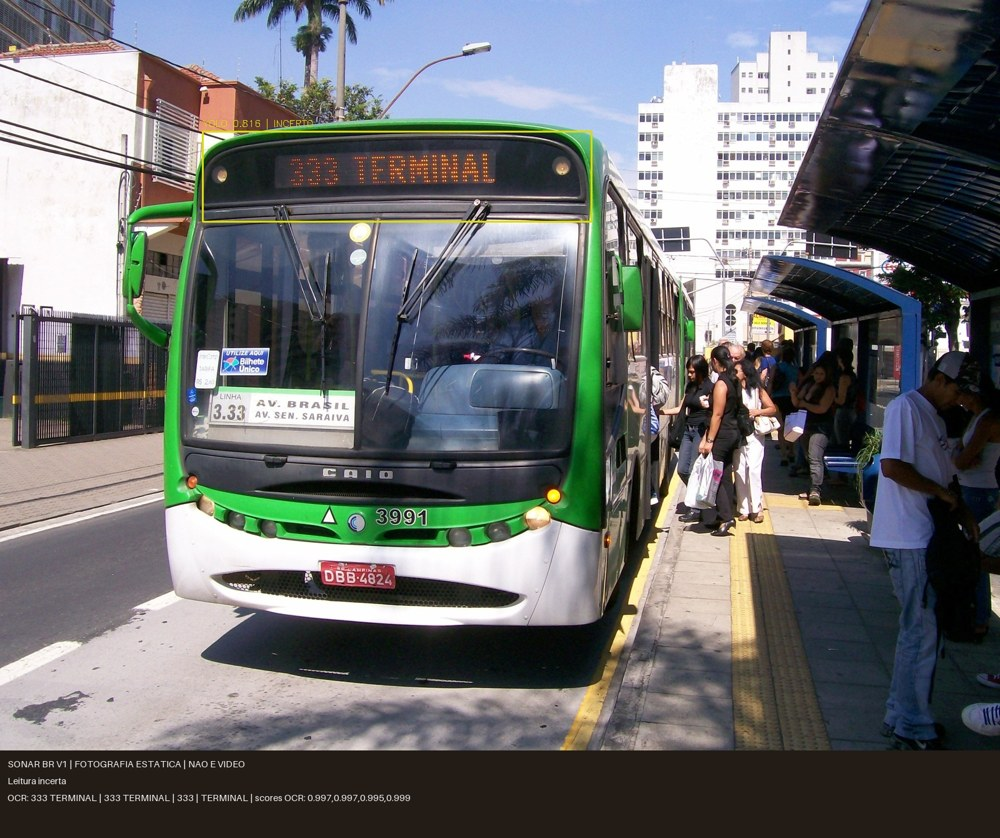
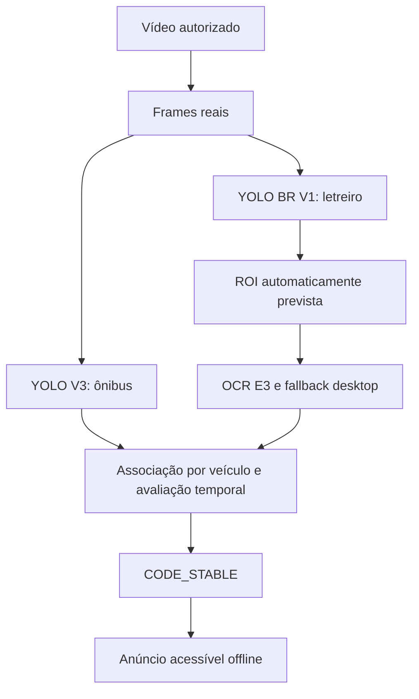

# SONAR VISION

**FIAP Global Solution 2026.2 · Applied Computer Vision**

[](https://github.com/Caique-Chagas/sonar-vision/actions/workflows/qa.yml)
[Relatório acadêmico PDF](reports/SONAR_VISION_FIAP.pdf) · [Resultados](docs/RESULTS.md) · [Reprodução](docs/REPRODUCIBILITY.md) · [Pesos](https://github.com/Caique-Chagas/sonar-vision/releases/tag/v0.2.0-fiap)

## Problema

Pessoas cegas ou com baixa visão enfrentam dificuldade para identificar o ônibus
que se aproxima do ponto. Letreiros pequenos, reflexos, movimento e alternância
de mensagens dificultam a leitura e tornam insuficiente uma observação isolada.

## Solução

O SONAR VISION é o componente de visão computacional do projeto Sonar. Detecta
ônibus e letreiros, lê a região prevista com OCR e agrega evidências por veículo.
Um código textual estável pode gerar anúncio acessível. O protótipo não confirma
destino, sentido, parada, correspondência operacional ou segurança de embarque.

**Estado acadêmico: parcialmente concluído.** A implementação e os resultados
estão documentados; gravação e submissão da apresentação são realizadas pelo aluno.
O vídeo narrado da apresentação é entregue separadamente à FIAP, fora deste GitHub.

## Demonstração técnica



**Fotografia estática, não vídeo:** BR V1 previu a caixa amarela e o OCR retornou
`333 TERMINAL`. Confiança YOLO: 0,816; OCR: aproximadamente 0,997. Estado incerto,
sem consenso temporal ou código completo. Não foi usada uma caixa de gabarito.
Foto de [Fasouzafreitas](https://commons.wikimedia.org/wiki/File:Embarque_pelo_lado_esquerdo_-_Campinas_-_SP.JPG),
[CC BY-SA 3.0](https://creativecommons.org/licenses/by-sa/3.0/).
Alterações: inferência, legendas e redimensionamento; derivado sob a mesma licença.

A demonstração desktop usa **inferência real pré-processada** para reproduzir em
velocidade normal. O playback não é inferência em tempo real. Os vídeos privados
de São Paulo e Santos não são redistribuídos; as contagens abaixo documentam a
execução local. Não há MP4 de apresentação na árvore atual deste repositório.

## Arquitetura



Os dois detectores operam sobre o frame. A associação do letreiro ao ônibus é usada
na etapa temporal. A alternativa hierárquica por recorte foi investigada, mas não
foi promovida: não melhorou o código no trecho escolhido. O texto bruto permanece
registrado, sem substituição por transcrição conhecida.

Código estável exige pelo menos três observações, razão de 75%, janela de oito
amostras a 5 Hz, intervalo mínimo de 0,3 s, confiança YOLO ≥0,35 e OCR ≥0,7.
Frames/pixels duplicados e caixas de tracking/interpolação não geram novos votos.
`CODE_STABLE` **não equivale a** `LINE_VERIFIED`; este último não foi emitido.

## Treinamento customizado

| Modelo | Classes e papel | Treinamento comprovado | Uso final |
|---|---|---|---|
| BR V1 | `destination_sign` | YOLO11n COCO ajustado por 40 épocas, 640 px, batch 2, AdamW, MPS | Detector de letreiro |
| V3 | `bus`, `destination_sign` | YOLO11n ajustado em 26 frames anotados; 16/5/5 treino/val/teste; execução encerrou em 9 épocas, melhor checkpoint na época 1 | Somente classe ônibus |
| Bangkok | `destination_sign` | Piloto histórico com 120 famílias, 84/18/18, 12 épocas | Baseline preservado, release anterior |

BR V1 utiliza 33 fotografias brasileiras licenciadas, divididas em 21/6/6 imagens
por grupos, com 19/5/5 painéis. Caixas representam o painel frontal completo.
A base pequena e a concentração de autores limitam a generalização.
V3 usa vídeos pessoais declarados pelo usuário e autorização de ML registrada no
desenvolvimento; as gravações não são públicas. O V3 não foi bem-sucedido como
 detector de letreiros: 0/5 painéis no pequeno teste anterior. Por isso o pipeline
mantém o BR V1 para essa classe.

Configurações, CSVs e curvas reais: [treinamento](docs/TRAINING.md).
Fontes, créditos e licenças: [datasets](docs/DATA_SOURCES.md).

## Resultados observados

| Vídeo selecionado | Frames | Frames com ônibus | Frames com letreiro/OCR | Leituras corretas de código completo | CODE_STABLE | Anúncios |
|---|---:|---:|---:|---:|---:|---:|
| São Paulo, 14:14–14:26 | 360 | 360 | 271 | 55 de `637P-10` | 21 | 1 |
| Santos A | 600 | 600 | 418 | 0 | 0 | 0 |
| Santos B | 600 | 600 | 452 | 0 | 0 | 0 |

São **contagens em vídeos conhecidos e selecionados para demonstração**, não
acurácia geral, capturas independentes ou precisão científica. O OCR não recebe o
código de referência. Em Santos há leituras parciais como `155` e `42`; nenhum
sufixo foi acrescentado e nenhum anúncio de código completo foi emitido.

No playback final, foram observados aproximadamente 59,2/60,0/29,9 FPS exibidos
em Santos A/B/São Paulo. A análise original de São Paulo tem mediana de cerca de
347 ms por frame em CPU; a reprodução fluida é obtida depois do processamento.
Ver [resultados e denominadores](docs/RESULTS.md) e [dados estruturados](reports/final-video-counts.json).

## Tecnologias

Python 3.11/3.12, PyTorch, Ultralytics YOLO11, PaddleOCR, OpenCV, FastAPI,
Pydantic, pytest, Ruff e mypy. A demonstração desktop foi validada no macOS Apple M1,
com Cocoa/AVFoundation para reprodução e `say`/Luciana para voz brasileira offline.
FFmpeg gera os MP4s. O OCR usa modelos oficiais PP-OCRv5 e o adapter E3 do projeto.

## Instalação

```sh
git clone https://github.com/Caique-Chagas/sonar-vision.git
cd sonar-vision
python3.12 -m venv .venv
.venv/bin/python -m pip install '.[dev,video]'
.venv/bin/python -m pytest
```

Para inferência real, instale os componentes opcionais e os dois pesos finais:

```sh
.venv/bin/python -m pip install '.[vision,paddle]'
.venv/bin/python scripts/download_runtime_models.py
```

Os modelos oficiais do PaddleOCR são obtidos na primeira inicialização; depois
podem ser usados em cache. Nenhuma chave Roboflow é necessária para o runtime.
Pesos BR V1/V3, checksums e licença estão na
[release v0.2.0-fiap](https://github.com/Caique-Chagas/sonar-vision/releases/tag/v0.2.0-fiap).
A exportação remove metadados locais e mantém todos os tensores idênticos.

Para executar uma inferência estática real no exemplo licenciado, após instalar
os pesos e componentes ML:

```sh
.venv/bin/python scripts/analyze_photo.py --output artifacts/photo-example
```

## Execução

**O clone não contém os três vídeos privados nem os caches de inferência.** Os
comandos desktop abaixo precisam de preparação adicional; não funcionam
imediatamente apenas com `git clone`. No Mac do desenvolvimento, os três perfis
já estão preparados. Para outro ambiente, use vídeos próprios/autorizados e siga
[REPRODUCIBILITY.md](docs/REPRODUCIBILITY.md), sem refazer treinamento.

```sh
./scripts/demo_final.sh
./scripts/demo_final.sh sao-paulo
./scripts/demo_final.sh santos-a
./scripts/demo_final.sh santos-b
./scripts/demo_final.sh all
./scripts/demo_final.sh --mute
```

M alterna áudio; ESPAÇO pausa; R reinicia; N troca; 1/2/3 selecionam perfis;
S salva o frame; Q/ESC fecha. `--audio` habilita voz. O modo padrão é `presentation`;
`--mode live` preserva a execução ao vivo para perfis locais configurados.
Um novo vídeo pode produzir resultados diferentes ou nenhum código estável.

A API/interface pode ser executada sem mídia privada, em modo de simulação
explicitamente identificado:

```sh
.venv/bin/uvicorn sonar_vision.api.app:app --host 127.0.0.1 --port 8000
```

Abra `http://127.0.0.1:8000`. Upload real de fotografia/MP4 exige pesos e dependências
opcionais. Simulação e fixtures não são evidência de reconhecimento real.

## Testes

Baseline local validado: **472 testes em Python 3.11 e 3.12**. A seleção pública
preserva 464 testes de aplicação; oito testes de diário/auditoria interna não são
publicados. Cinco regressões adicionais verificam o download dos pesos finais:
**469 testes públicos**. Não houve desativação de testes para ocultar falhas.

```sh
.venv/bin/python -m pytest
.venv/bin/ruff check .
.venv/bin/ruff format --check src scripts tests notebooks sonar_br
.venv/bin/mypy src
.venv/bin/python -m pip check
```

A CI testa software com fixtures pequenas, sem vídeos privados, pesos, tokens ou
modelos ML. Os testes não estimam a acurácia da visão. Ver [QA](docs/QA_REPORT.md).

## Documentação acadêmica

[PDF oficial](reports/SONAR_VISION_FIAP.pdf): 14 páginas, versão revisada de 19/11/2026 fornecida pelo grupo,
com integrantes/RMs conferidos. A expressão solicitada foi removida no documento
revisado; o PDF não foi reescrito nesta publicação. A apresentação narrada é enviada separadamente pelo aluno à FIAP.
[Arquitetura](docs/ARCHITECTURE.md) · [Treinamento](docs/TRAINING.md) ·
[Resultados](docs/RESULTS.md) · [Modelos](docs/MODEL_CARD.md) ·
[Mapa de publicação](docs/PUBLICATION_MAP.md).

## Limitações

- Validação geral em novos veículos e encontros ainda limitada; amostras pequenas.
- `CODE_STABLE` é consenso textual, não verificação operacional de linha.
- Playback pré-processado não comprova inferência em tempo real.
- Integração operacional completa com SPTrans e condições de embarque não demonstradas.
- Iluminação, ângulo, distância, reflexos, LED e resolução afetam o resultado.
- Persistem perdas momentâneas de detecção; não são preenchidas com caixas fictícias.
- O relatório registra escuta informal pelo usuário; falta estudo assistivo com usuários.
- Reproduzir exatamente as contagens dos vídeos privados requer os mesmos dados,
  indisponíveis neste clone. Código, configurações, pesos e testes estão disponíveis.

## Integrantes

| Nome | RM |
|---|---|
| Caique Chagas Nitta | 551943 |
| Rodrigo Resende Viana | 551057 |
| Gabriel Torres Luiz | 98600 |
| Otavio Vitoriano Da Silva | 552012 |
| Eduardo Fedeli | 550132 |

Código e pesos distribuídos sob [AGPL-3.0-only](LICENSE). Fotografias/figuras têm
licenças próprias indicadas nos [créditos](docs/ASSET_CREDITS.md); não são relicenciadas
como código. Nenhum material implica endosso dos autores ao protótipo.
