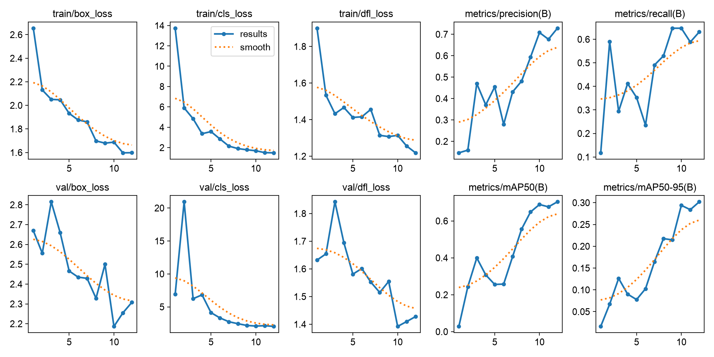

# SONAR VISION: identificação visual de linhas de ônibus

Global Solution FIAP 2026.2 — CitizenTech — Engenharia de Software

Disciplina: Applied Computer Vision — Atividade: Enxergando o Mundo Real.
Professores: Arnaldo Viana e Paulo Rodrigues.
Data deste relatório: 10/11/2026. Prazo informado: 19/11/2026 às 23h55, São Paulo.

## Integrantes

- Caique Chagas Nitta — RM551943
- Rodrigo Resende Viana — RM551057
- Gabriel Torres Luiz — RM98600
- Otavio Vitoriano Da Silva — RM552012
- Eduardo Fedeli — RM550132

## Resumo

O SONAR VISION investiga a identificação visual de linhas de ônibus como apoio
informacional a pessoas cegas ou com baixa visão no transporte público. O
protótipo integra detecção customizada de letreiros, reconhecimento óptico de
caracteres, normalização conservadora e consolidação temporal, disponibilizando
eventos estruturados, interface acessível e comunicação por áudio. A arquitetura
utiliza YOLO11n, PaddleOCR, OpenCV, Pydantic e FastAPI, com processamento
incremental e limites explícitos de recursos. O experimento adotou procedimentos reproduzíveis, com testes automatizados,
rastreabilidade dos dados, configurações versionadas, verificação das fontes
e preservação dos artefatos. Para o experimento inicial,
foram selecionadas 120 famílias de fotografias do Bangkok-Bus-Dataset, cuja
licença declarada permite reutilização com atribuição. Os rótulos de regiões
que exibem números de linha foram convertidos para a classe destination_sign.
A divisão adotou 84 exemplos para treinamento, 18 para validação e 18 para
teste, mantendo famílias separadas e verificando duplicatas. Foi realizado
ajuste real dos pesos pré-treinados durante 12 épocas em Apple M1 com MPS.
No teste reservado, o detector apresentou mAP50 de 0,644 e recall de 0,471,
evidenciando limitações na recuperação dos letreiros. A avaliação exploratória
do OCR obteve oito leituras exatas em nove recortes legíveis; outros oito
recortes foram excluídos por ilegibilidade. Esses resultados não comprovam
desempenho em linhas brasileiras, pois faltam identificação de sequências e
validação operacional independente. A aplicação preserva incertezas, exige
múltiplas observações para confirmar códigos e não autoriza embarque. A
entrega inclui código executável, evidências, documentação técnica e materiais
demonstrativos, permanecendo necessária a validação com dados brasileiros
representativos antes de qualquer uso por passageiros.

## Introdução

A identificação do ônibus que se aproxima é uma barreira de acesso à informação
para passageiros com deficiência visual. Conhecer a linha desejada não garante
conseguir distinguir seu letreiro entre vários veículos no ponto. O SONAR
propõe combinar dados operacionais e comunicação acessível; este componente
implementa exclusivamente a percepção visual, sem substituir a decisão do passageiro.

Letreiros eletrônicos apresentam reflexos, iluminação variável, caracteres pequenos,
alternância de mensagens e desfoque. Uma leitura isolada pode ser plausível e
incorreta. Por isso, a proposta inclui rejeição explícita, evidências temporais e
separação entre o código reconhecido e a correspondência contextual. Não há
confirmação de destino, sentido, parada efetiva ou embarque neste MVP.

## Objetivo

Desenvolver um protótipo reproduzível que detecte regiões de identificação em
ônibus, reconheça códigos de linha e consolide leituras por veículo observado,
emitindo eventos e mensagens acessíveis com incerteza explícita. Avaliar
separadamente detector, OCR e integração, documentando treinamento customizado,
limitações dos dados e condições necessárias para futura validação com ônibus brasileiros.

## Ferramentas e arquitetura

Python 3.12.16 executa os módulos testáveis. Ultralytics 8.4.209 fornece YOLO11n,
inicializado com pesos oficiais e ajustado especificamente à região que exibe
o número da linha. PyTorch 2.15.0 usa MPS no Apple M1. A detecção genérica
pré-treinada não é apresentada como substituta do treinamento customizado.

PaddleOCR 3.7.0 e PaddlePaddle 3.3.1 executam PP-OCRv5_mobile_det e
en_PP-OCRv5_mobile_rec. A interface abstrata permite substituir o motor,
sem introduzir um segundo backend desnecessário. O modelo de reconhecimento
é voltado a caracteres latinos e dígitos; reconhecimento de destinos está fora
da comprovação atual. Os scores devolvidos pelo motor são preservados.

OpenCV 4.10.0 extrai e redimensiona regiões, limita a leitura de vídeo e desenha
caixas para observação. O pré-processamento padrão conserva a aparência do
recorte; CLAHE é uma opção experimental, sem alegação de superioridade medida.
Tracking por interseção sobre união mantém evidências locais de curta duração.
Não existe identidade persistente ou garantia em cruzamentos e oclusões.

FastAPI publica API REST e serve HTML, CSS e JavaScript. Pydantic valida os
contratos. Sessões reais executam em subprocesso cancelável e fila limitada,
sem bloquear o servidor. A interface oferece labels, teclado, contraste,
mensagens textuais e histórico. SpeechSynthesis anuncia estados quando o
navegador e suas vozes permitem; os resultados permanecem disponíveis em texto.

Fluxo: VideoSource > FrameProcessor > YOLO > Tracking > ROI > OCR >
LineNormalizer > TemporalValidator > RouteMatcher > VisionEvent > Interface/SONAR.

## Metodologia

1. Caracterizar hardware e versões; criar ambiente isolado e preservar as
   configurações do experimento. O computador dispõe de Apple M1, MPS e 8 GiB de RAM.
2. Consultar documentação oficial e verificar candidatos a dados. O repositório
   ICMC não foi usado por ausência de licença declarada; a exportação do candidato
   Roboflow demanda credencial e sua versão não contém avaliação reservada.
3. Selecionar o espelho público do autor do Bangkok-Bus-Dataset, fixando commit
   cacdb66543150261916da59eaa6ce34d89f6839e e licença declarada CC BY 4.0.
4. Baixar uma amostra limitada, sem vídeos completos e sem contratar computação.
   Selecionar uma versão publicada por fotografia de origem. Aumentações anteriores
   feitas pelo publicador continuam presentes e são documentadas.
5. Remapear somente Bus Line Number para destination_sign. Converter polígonos
   dessa classe em envelopes retangulares verificáveis e preservar os originais.
   O nome da classe corresponde à região do código, sem afirmar leitura do destino.
6. Descartar o YAML original, que usa as mesmas imagens em treino, validação e
   teste. Criar divisão 84/18/18 por família com semente 42; registrar hashes e
   rejeitar duplicatas ou quase duplicatas entre splits. IDs de veículo/filmagem
   não estão disponíveis: independência por encontro não foi comprovada.
7. Executar smoke test separado de uma época, resolução 320 e batch 2. Depois
   realizar treino real por 12 épocas, resolução 416, batch 4 e patience 4.
   Desativar espelhamento para não inverter texto e usar aumentações moderadas.
8. Selecionar o melhor checkpoint pela validação e avaliar uma vez o teste
   reservado a 640 pixels. Preservar best.pt, last.pt, checkpoints periódicos,
   args.yaml, results.csv, gráficos e hashes.
9. Avaliar OCR nos recortes de teste com transcrições visuais provisórias do
   agente: nove legíveis, oito excluídos. Comparar o texto completo após normalizar
   somente Unicode, caixa, espaços e hífen; não escolher leituras pelo gabarito.
10. Implementar normalização com catálogo opcional e consenso por track. Exigir
    três frames distintos em intervalo mínimo de 0,3 segundo, proporção de apoio
    de 0,75 na janela de oito observações e limiares iniciais de detector/OCR.
    Códigos abreviados e correções ambíguas permanecem incertos.
11. Testar API, proteção de fontes, cancelamento e navegador; registrar resultados
    reais separadamente de fixtures e simulação. O contexto operacional é um
    adaptador, com catálogo fictício restrito à simulação.

## Resultados e exemplos

### Detector customizado

Avaliação de 18 imagens reservadas, 17 regiões anotadas, resolução 640,
dispositivo MPS. Dados de ônibus de Bangkok, sem garantia de independência
por veículo/filmagem. Não foram usados resultados de treino como teste.

| Métrica | Resultado |
| --- | --- |
| Precision | 0,9358 |
| Recall | 0,4706 |
| mAP50 | 0,6439 |
| mAP50-95 | 0,2884 |
| Inferência por imagem, somente detector | 16,90 ms |
| Pré-processamento / pós-processamento | 1,25 ms / 8,43 ms |

Precision e recall acima são os valores agregados pela avaliação Ultralytics;
não equivalem à precisão de confirmação temporal no limiar da aplicação.
O recall baixo indica quantidade relevante de letreiros não recuperados.
Latência apenas do detector não inclui OCR, rede ou inicialização.

Figura 1 — Curvas reais da execução de 12 épocas. Evidência detalhada em
reports/training e reports/evaluation, com hashes do modelo e dos dados.

### OCR e integração por imagem

Dos 17 recortes de letreiro no teste, nove foram considerados legíveis por
inspeção visual provisória e oito não receberam transcrição confiável. O OCR
acertou integralmente oito dos nove recortes pontuados: 88,9% nesse subconjunto.
Isso não representa acurácia sobre todos os letreiros ou linhas brasileiras.
A transcrição deve receber revisão humana e os casos excluídos devem ser
considerados ao projetar a política de rejeição.

Na integração de imagem completa, o detector encontrou seis regiões nas 18
imagens no limiar inicial da aplicação, e o OCR foi chamado seis vezes. Leituras
reais incluíram 166, 1-50 e 137(a-48). As observações permaneceram UNCERTAIN:
eram frames isolados e não eram códigos brasileiros solicitados. Nenhum destino
ou confirmação de embarque foi inventado.

### Vídeo, eventos e interface

Uma fonte HTTPS direta do Wikimedia Commons foi aberta pelo relay, sem salvar
o vídeo no disco. No ensaio inicial com o vídeo estrangeiro Road traffic in
Ljubljana, 100 frames foram processados, sem letreiros detectados e sem chamadas
OCR. A latência média do processamento foi 60,96 ms/frame; a vazão observada
incluindo inicialização e espera foi 2,97 frames/s. Portanto, esse ensaio comprova
o transporte e a execução do detector, mas não comprova reconhecimento temporal
de linha por OCR em vídeo real.

A demonstração artificial exercita MATCH, NON_MATCH e UNCERTAIN. Ela usa cenas
e leituras declaradamente simuladas, sem afirmar que YOLO ou OCR reconheceram
aqueles códigos. O navegador Chromium foi testado em desktop e largura móvel,
sem erro JavaScript observado nem transbordamento horizontal. Há gravação
automática da simulação, sem áudio capturado. A reprodução acústica da voz e
uso com leitor de tela ainda dependem de verificação humana.

O ensaio adicional com o vídeo estrangeiro completo processou 193 frames, ainda
sem letreiros detectados, com 64,44 ms/frame no processamento e 3,54 frames/s
observados incluindo inicialização/espera. Foi também explorado um vídeo público
da Câmara SP: 80 frames nos 40 segundos iniciais, 4,52 MB transferidos, sem
detecções; o trecho mostra apresentação em estúdio, não ônibus. A tentativa de
pesquisar offsets posteriores falhou; busca temporal remota não é funcionalidade
oferecida pelo MVP. Nenhum desses ensaios comprova leitura de linha brasileira.

| Métrica do sistema | Situação |
| --- | --- |
| Identificação correta por ônibus brasileiro | NÃO MEDIDA — falta conjunto temporal brasileiro anotado |
| Taxa de falso positivo por encontro | NÃO MEDIDA — falta conjunto de encontros positivos e negativos |
| Taxa de rejeição correta | NÃO MEDIDA — falta ground truth por encontro |
| Acurácia OCR brasileira | NÃO MEDIDA — conjunto OCR atual é estrangeiro e pequeno |
| Desempenho com múltiplos ônibus reais | NÃO MEDIDA — testes atuais são determinísticos, não validação de campo |

## Qualidade, segurança e acessibilidade

A suíte automatizada cobre contratos, caixas, entradas inválidas, filtros, OCR
substituído em teste, normalização, múltiplos tracks, contradições, expiração,
limites de vídeo, API, deduplicação, legado, SSRF e encerramento de workers.
O piloto aprovou 104 testes, Ruff, mypy e pip check. A edição de publicação acrescenta quatro testes de integridade de download; seu resultado está no relatório de QA. A cobertura de statements foi 80,88%. Resultados e limites estão em docs/QA_REPORT.md e reports.
Esses testes de software não são métricas do modelo de visão.

A API escuta apenas em localhost. URLs precisam de host autorizado, IP público
verificado, TLS e ausência de redirecionamento. A fonte é limitada em bytes,
frames e tempo. Eventos não transportam imagens, tempo parado permanece nulo,
e scores de detector/OCR ficam separados, sem probabilidade global artificial.
Frames ficam somente na memória; evidências demonstrativas têm finalidade
explícita e origem licenciada. Pesos e dados grandes não integram o Git.

Cada informação relevante possui texto acessível. A interface evita depender
somente de cor, fornece foco visível e permite repetir o anúncio manualmente.
O protótipo ainda necessita de avaliação com usuários e tecnologias assistivas.

### Apresentação técnica narrada

Foi produzido artifacts/demo/pilot-narrated.mp4, com 148,75 segundos, resolução
1600×900, vídeo H.264 e áudio AAC sintetizado localmente em português. A apresentação
mostra evidências reais de treino e uma inferência em imagem reservada: a região
prevista pelo detector retornou o texto 166 no OCR, sem confirmação temporal.
A captura de interface é identificada como simulação. Decodificação completa de
áudio e vídeo foi verificada; revisão acústica humana continua pendente.
Há transcrição, legendas com tempos aproximados e créditos CC BY 4.0. O vídeo
ilustra o piloto e suas limitações; não valida identificação brasileira por encontro.

## Limitações e trabalhos pendentes

- Piloto pequeno, dados estrangeiros, letreiros heterogêneos e recall limitado.
- Ausência de IDs de sequência/veículo no dataset de treino e teste.
- Transcrição OCR provisória e seleção de um subconjunto legível.
- Limiares temporais e scores sem calibração operacional.
- Tracking leve sem ReID ou associação do painel ao ônibus completo.
- Sem validação por encontros brasileiros positivos, negativos e ambíguos.
- Notebook Colab preparado, porém não executado remotamente nesta sessão.
- Repositório de avaliação: https://github.com/Caique-Chagas/sonar-vision. A validação brasileira permanece pendente.
- Vídeo piloto narrado produzido; revisão humana de áudio/legendas e
  complementação com encontros brasileiros anotados permanecem pendentes.

## Conclusão

O projeto entregou um componente modular executável, treino customizado real,
avaliação reservada do detector, OCR funcional, regras conservadoras de validação
e interface demonstrativa acessível. As evidências sustentam a viabilidade
técnica do pipeline e revelam limitações concretas, especialmente recall e
transferência entre domínios. A aplicação evita transformar leituras ambíguas
em autorização de embarque. O estado é PARTIALLY_COMPLETED: é necessário
avaliar encontros brasileiros anotados, revisar áudio e tecnologias assistivas
e calibrar a decisão temporal antes de declarar o projeto validado.

## Referências

- [Ultralytics YOLO11](https://docs.ultralytics.com/models/yolo11/), [treino](https://docs.ultralytics.com/modes/train/) e [avaliação](https://docs.ultralytics.com/modes/val/).
- [PaddleOCR: OCR 3.x](https://www.paddleocr.ai/main/en/version3.x/pipeline_usage/OCR.html).
- [OpenCV VideoCapture](https://docs.opencv.org/4.x/d8/dfe/classcv_1_1VideoCapture.html).
- [PyTorch MPS](https://docs.pytorch.org/docs/2.15/notes/mps.html).
- [FastAPI](https://fastapi.tiangolo.com/) e [SpeechSynthesis](https://developer.mozilla.org/en-US/docs/Web/API/SpeechSynthesis).
- [Bangkok-Bus-Dataset, SAINT70239, CC BY 4.0](https://universe.roboflow.com/saint70239/bangkok-bus-dataset), [espelho do autor](https://github.com/llsrwsaint225/Bangkok-Bus-Dataset-YOLOV8). Modificações: subconjunto, classes, polígonos e splits.
- [Road traffic in Ljubljana, Sounds of Changes, CC BY 3.0](https://commons.wikimedia.org/wiki/File:Road_traffic_in_Ljubljana.webm). Uso para ensaio de streaming e inferência exploratória.
- [Apartes — SP 24h — Bloco 1/3, Câmara SP, CC BY 3.0](https://commons.wikimedia.org/wiki/File:Apartes_Grandes_Reportagens_-_SP_24h_-_Bloco_1-3.webm). Inspeção exploratória de fonte, sem validação de linhas.

Referências consultadas em 10/11/2026; detalhes de proveniência, versões e
licenças em docs/DATA_SOURCES.md, docs/REFERENCES.md e reports/environment.txt.
